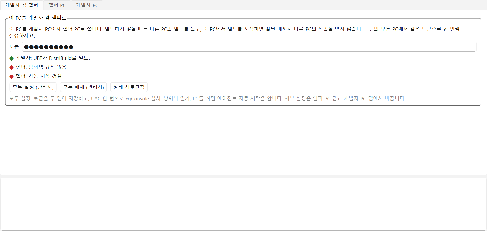
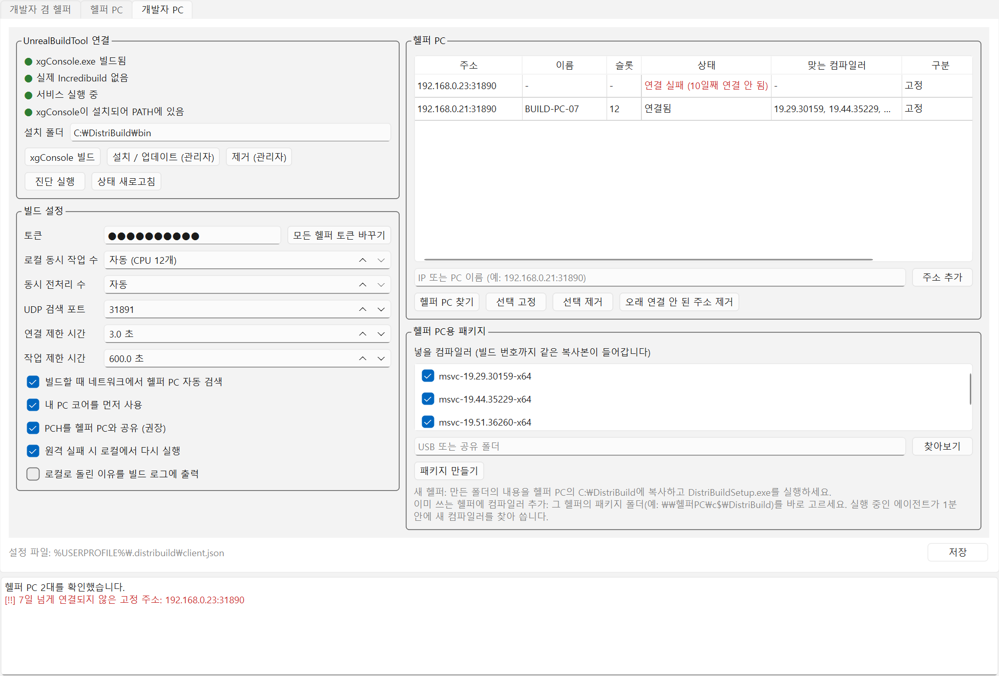
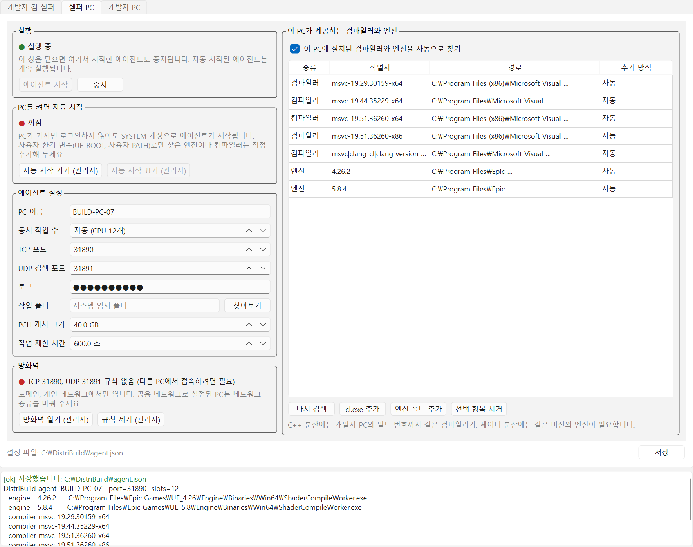
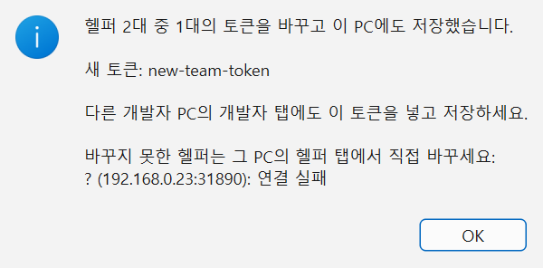

# DistriBuild — 언리얼 엔진용 분산 빌드 가속기

Incredibuild처럼 LAN의 여러 PC에 빌드 작업을 나눠 실행합니다. **UE 4.26과 UE 5.8**에서 동작합니다. 엔진 수정은 필요 없습니다.

| 대상 | 방식 | 구성 요소 |
|---|---|---|
| **C++ 컴파일** | UBT의 XGE 실행기가 호출하는 `xgConsole.exe`를 대체합니다. 로컬에서 전처리하고, PCH를 재사용해 원격에서 같은 컴파일러로 컴파일한 뒤 `.obj`를 돌려받습니다. | `Tools/DistriBuild/xgconsole.py`, `install_client.bat` |
| **셰이더 컴파일** | 엔진의 `IDistributedBuildController` 훅(엔진의 XGE 컨트롤러가 쓰는 것과 같은 인터페이스)을 구현해 ShaderCompileWorker 작업을 에이전트로 보냅니다. | `Plugin/DistriBuild` (에디터 플러그인) |
| **헬퍼 PC** | 작업을 받아 실행하는 에이전트입니다. UDP로 자동 검색됩니다. | `Tools/DistriBuild/agent.py` |

```
 개발자 PC                                             헬퍼 PC (N대)
┌──────────────────────────┐   TCP 31890 (zlib)    ┌──────────────────────────┐
│ UnrealEditor             │ ────────────────────▶ │ DistriBuild Agent        │
│  └ DistriBuild plugin    │   셰이더 작업          │  ├ ShaderCompileWorker   │
│     (셰이더 컨트롤러)      │                       │  │  (같은 엔진 버전)       │
│ UBT ─▶ xgConsole.exe     │ ────────────────────▶ │  └ cl.exe                │
│       (DistriBuild)      │ PCH 캐시 + 텍스트→.obj │     (같은 컴파일러 버전)    │
└──────────────────────────┘ ◀─ UDP 31891 검색 ──▶  └──────────────────────────┘
```

## 동작 방식

- **슬롯 스케줄링**: 에이전트마다 슬롯 수(기본값: CPU 코어 수)가 정해져 있습니다. 클라이언트는 부하가 가장 낮은 에이전트에 `reserve`를 보내고, 슬롯이 꽉 찼으면 다음 에이전트를 시도합니다. 중앙 코디네이터는 필요 없습니다.
- **호환성 보장**: 셰이더 작업은 엔진 버전(`5.8.4`)이 같은 에이전트에만, C++ 작업은 컴파일러 빌드(`msvc-19.44.35229-x64`)가 정확히 같은 에이전트에만 보냅니다.
- **로컬 폴백**: 원격 작업이 실패하거나 받을 에이전트가 없으면 로컬에서 다시 실행합니다. 코드 오류는 로컬 컴파일러가 다시 보고하므로 빌드 결과는 로컬 빌드와 같습니다.
- **소스 동기화가 필요 없음**: C++는 전처리된 텍스트와 PCH만 보냅니다. 에이전트 PC에는 같은 버전의 컴파일러만 있으면 됩니다. 셰이더는 5.8에서는 작업 파일에 소스가 들어 있고, 4.26에서는 셰이더 폴더를 번들로 올려 에이전트가 해시별로 캐시합니다.
- **한 PC가 개발자 겸 헬퍼**: 모든 PC에 개발자 설치와 에이전트를 함께 둘 수 있습니다. 빌드하지 않는 PC는 헬퍼로 쓰이고, 어떤 PC에서 C++ 빌드를 시작하면 그 PC의 에이전트는 빌드가 끝날 때까지 다른 PC의 새 작업을 받지 않습니다(받고 있던 작업은 마칩니다). 그 PC의 빌드에는 자기 에이전트를 쓰지 않습니다. 자기 코어는 이미 로컬 슬롯이기 때문입니다.

## GUI로 설정하고 사용하기 (Qt)

설정 창 `Tools\DistriBuild\setup_gui.py`는 아래 "터미널로 설정하고 사용하기"의 ②~④를 대신합니다. 같은 `agent.json`과 `client.json`을 고치므로 명령줄 도구와 섞어 써도 됩니다. 셰이더 분산(⑤)은 창에서 설정하지 않습니다.

### 준비: 설정 창 실행하기

개발자 PC에서 한 번 실행합니다. Python 3.9 이상이 필요합니다.
```bash
pip install PySide6-Essentials pyinstaller
```
```bash
python Tools\DistriBuild\setup_gui.py
```
헬퍼 PC에는 Python이 없어도 됩니다. 개발자 PC에서 실행 파일을 만들어 패키지로 보냅니다.
```bash
Tools\DistriBuild\build_xgconsole.bat
```
```bash
Tools\DistriBuild\build_setup_gui.bat
```
`Tools\DistriBuild\dist\`에 `xgConsole.exe`, `DistriBuildAgent.exe`, `DistriBuildSetup.exe`가 생깁니다. 개발자 탭의 **xgConsole 빌드** 버튼은 앞의 두 개만 만듭니다.

창은 **개발자 겸 헬퍼**, **헬퍼 PC**, **개발자 PC** 탭으로 나뉩니다. 아래쪽 칸에는 버튼을 누를 때마다 진행 상황이 나옵니다. `[ok]`는 초록색, `[!!]`는 빨간색입니다. 관리자라고 적힌 버튼은 누를 때 UAC 창이 뜹니다.

### 모든 PC를 개발자 겸 헬퍼로 쓰기 (권장)

어느 PC가 빌드하고 어느 PC가 도울지 정해져 있지 않다면, 모든 PC를 똑같이 설정합니다.



1. 한 PC에서 위의 준비를 마치고, 개발자 PC 탭의 **헬퍼 PC용 패키지**로 패키지를 만듭니다(→ 2단계). 패키지에는 헬퍼 프로그램과 함께 개발자 설치에 필요한 `install_client.bat`, `xgConsole.exe`도 들어갑니다.
2. 모든 PC(패키지를 만든 PC 포함)에서 패키지 폴더 내용을 로컬 디스크(예: `C:\DistriBuild`)에 복사하고 `DistriBuildSetup.exe`를 실행합니다.
3. **개발자 겸 헬퍼** 탭에서 팀이 함께 쓸 **토큰**을 넣고 **모두 설정 (관리자)**를 누릅니다. UAC 한 번으로 다음을 합니다.
   - 토큰을 헬퍼 설정(`agent.json`)과 개발자 설정(`client.json`)에 저장
   - xgConsole 설치 (1단계의 설치와 같음)
   - 방화벽 열기
   - PC를 켜면 에이전트 자동 시작
4. 세 줄이 모두 초록색이면 끝입니다. Visual Studio를 다시 시작합니다. 새 PC를 추가할 때도 2~3을 하면 됩니다. 같은 네트워크의 PC는 서로 자동으로 찾습니다.

설정이 끝나면 이렇게 동작합니다.
- 빌드하지 않는 PC는 다른 PC의 헬퍼입니다. 에이전트는 낮은 우선순위로 돌아서 그 PC를 쓰는 사람의 작업이 먼저 CPU를 씁니다.
- 어떤 PC에서 C++ 빌드를 시작하면, 그 PC의 에이전트는 빌드가 끝날 때까지 다른 PC의 새 작업을 받지 않습니다. 받고 있던 작업은 마칩니다. 다른 PC는 그동안 그 PC를 건너뛰고, 빌드가 끝나면 다시 씁니다.
- 빌드 출력에 `this PC's agent (...) takes no work from other PCs during this build`가 나옵니다. 개발자 PC 탭의 **헬퍼 PC** 표에서는 자기 PC가 **구분** "이 PC"로, 빌드 중인 다른 PC는 "연결됨 (자기 빌드 중이라 쉼)"으로 나옵니다.
- 빌드가 비정상 종료되어도 30초 안에 그 PC의 에이전트가 다시 작업을 받습니다.
- **에디터의 셰이더 컴파일과 쿠킹은 아직 이 규칙을 따르지 않습니다.** 그동안에도 그 PC의 에이전트는 다른 PC의 작업을 받습니다.

**모두 해제 (관리자)**는 xgConsole 제거, 방화벽 규칙 제거, 자동 시작 끄기를 한 번에 합니다. 역할을 하나만 쓰는 PC는 아래 1~4단계처럼 탭별로 설정해도 됩니다.

### 1단계: 개발자 PC 연결하기 (개발자 PC 탭)



1. **UnrealBuildTool 연결**에서 **설치 / 업데이트 (관리자)**를 누릅니다. 네 줄이 모두 초록색이 되면 UBT가 빌드를 DistriBuild로 보냅니다. `xgConsole.exe가 없음`이 나오면 먼저 **xgConsole 빌드**를 누르세요.
2. **빌드 설정**의 **토큰**에 팀이 함께 쓸 문자열을 넣습니다. 헬퍼 PC에도 같은 토큰을 넣습니다. 비워 두면 인증하지 않습니다.
3. 오른쪽 아래 **저장**을 누릅니다. `%USERPROFILE%\.distribuild\client.json`에 저장됩니다.
4. Visual Studio를 다시 시작합니다. PATH 변경은 새로 연 프로그램부터 적용됩니다.

**빌드 설정** 항목은 기본값 그대로 써도 됩니다.

| 항목 | 뜻 |
|---|---|
| 로컬 동시 작업 수 | 이 PC에서 동시에 돌릴 컴파일 수. 자동이면 CPU 수 |
| 동시 전처리 수 | 원격으로 보낼 파일을 이 PC에서 동시에 전처리하는 수. 헬퍼가 많은데 원격 슬롯이 놀면 올립니다 |
| UDP 검색 포트 | 헬퍼 PC 자동 검색 포트. 헬퍼 탭의 값과 같아야 합니다 |
| 연결 제한 시간 | 헬퍼 PC 한 대가 응답하길 기다리는 시간 |
| 작업 제한 시간 | 원격 작업 하나를 기다리는 최대 시간. 넘으면 로컬에서 다시 실행합니다 |
| 빌드할 때 네트워크에서 헬퍼 PC 자동 검색 | 끄면 **헬퍼 PC** 표에 고정한 주소만 씁니다 |
| 내 PC 코어를 먼저 사용 | 작은 빌드는 원격으로 보내지 않고 이 PC에서 끝냅니다 |
| PCH를 헬퍼 PC와 공유 | 끄면 파일마다 헤더 전체를 보내 매우 느려집니다 |
| 원격 실패 시 로컬에서 다시 실행 | 끄면 원격 실패가 빌드 실패가 됩니다 |
| 로컬로 돌린 이유를 빌드 로그에 출력 | 분산이 잘 안 될 때 켜서 원인을 봅니다 |

### 2단계: 헬퍼 PC용 패키지 만들기 (개발자 PC 탭)

헬퍼 PC에 같은 Visual Studio가 같은 버전으로 설치되어 있지 않다면 이 PC의 컴파일러를 함께 보냅니다.

1. **헬퍼 PC용 패키지**의 **넣을 컴파일러**에서 보낼 컴파일러를 고릅니다. 어느 것을 UBT가 쓰는지 모르면 모두 두세요(하나에 약 100MB).
2. **찾아보기**로 USB나 공유 폴더를 고르고 **패키지 만들기**를 누릅니다.
3. 그 폴더에 `DistriBuildSetup.exe`, `DistriBuildAgent.exe`, 빈 설정 파일 `agent.json`, `msvc\<컴파일러 ID>\`가 생깁니다. 그 PC를 개발자 PC로도 쓸 수 있도록 `install_client.bat`, `uninstall_client.bat`, `service\`, `dist\xgConsole.exe`도 들어갑니다.

### 3단계: 헬퍼 PC 설정하기 (헬퍼 PC 탭)



1. 패키지 폴더의 내용을 헬퍼 PC의 로컬 디스크에 통째로 복사하고 `DistriBuildSetup.exe`를 실행합니다. 헬퍼 PC 탭이 열립니다. 이 문서는 `C:\DistriBuild`를 예로 들지만 어느 폴더든 됩니다. 자동 시작은 SYSTEM 계정으로 돌아 네트워크 드라이브를 보지 못하므로 로컬 디스크에 두세요.
2. **에이전트 설정**의 **토큰**에 1단계와 같은 토큰을 넣고 **저장**합니다. 프로그램 옆의 `agent.json`(예: `C:\DistriBuild\agent.json`)에 저장되고, 자동 시작 로그도 그 옆에 남습니다. 옆에 `agent.json`이 없으면 `%USERPROFILE%\.distribuild\agent.json`을 씁니다. 나머지 항목은 기본값으로 충분합니다.
   - **PC 이름**: 개발자 탭에 보일 이름. 비우면 Windows PC 이름
   - **동시 작업 수**: 받을 작업 수. 헬퍼 PC를 사람도 쓰면 CPU 수보다 낮춥니다
   - **작업 폴더**, **PCH 캐시 크기**: 작업 파일과 PCH 캐시를 둘 곳(비우면 시스템 임시 폴더), PCH 캐시의 최대 크기
3. **방화벽**에서 **방화벽 열기 (관리자)**를 누릅니다. 빨간 줄이 초록색이 되어야 다른 PC에서 접속할 수 있습니다.
4. **PC를 켜면 자동 시작**에서 **자동 시작 켜기 (관리자)**를 누릅니다. 바로 에이전트가 시작되고, 이후에는 PC가 켜질 때 로그인하지 않아도 시작됩니다. 잠깐 시험만 할 때는 **실행**의 **에이전트 시작**을 써도 됩니다. 이 경우 창을 닫으면 에이전트도 멈춥니다.
5. 오른쪽 **이 PC가 제공하는 컴파일러와 엔진** 표에서 개발자 PC와 같은 컴파일러 ID(`msvc-19.44.35229-x64` 같은)가 있는지 봅니다. 패키지로 받은 컴파일러는 추가 방식이 "패키지"로, 이 PC에 설치된 것은 "자동"으로 나옵니다. 셰이더 작업도 받으려면 개발자 PC와 같은 버전의 엔진이 "엔진" 줄에 있어야 합니다. 다른 위치의 컴파일러나 엔진은 **cl.exe 추가**, **엔진 폴더 추가**로 넣습니다.

자동 시작에 대해 더 알아 둘 것입니다.
- 작업 스케줄러에 `DistriBuild Agent` 작업을 SYSTEM 계정으로 등록합니다. 보통보다 낮은 우선순위로 돌아 헬퍼 PC를 쓰는 사람에게 방해가 덜 됩니다.
- 로그는 설정 파일 옆의 `agent-autostart.log`에 남습니다(5MB가 넘으면 `.old`로 바꿉니다).
- 설정을 바꿨으면 저장한 뒤 **설정 적용해 다시 시작**을 누릅니다. 패키지 폴더를 옮기면 **이 위치로 다시 등록**이 나타납니다.
- SYSTEM 계정은 사용자 환경 변수(`UE_ROOT`, 사용자 PATH)를 보지 못하므로, 그렇게만 찾은 엔진과 컴파일러는 직접 추가해 두세요.

### 4단계: 헬퍼 PC가 보이는지 확인하기 (개발자 PC 탭)

1. **헬퍼 PC**에서 **헬퍼 PC 찾기**를 누릅니다. 같은 네트워크의 헬퍼가 표에 나옵니다.
2. **상태**가 "연결됨"이고 **맞는 컴파일러**에 컴파일러가 하나 이상 있으면 준비가 끝났습니다. 줄에 마우스를 올리면 이 PC에는 있지만 헬퍼에 없는 컴파일러도 보입니다.

   | 상태 | 뜻과 조치 |
   |---|---|
   | 연결됨 | 정상 |
   | 토큰이 맞지 않음 | 두 탭의 토큰을 같게 맞추고 저장 |
   | 연결 실패 | 헬퍼의 에이전트가 꺼짐, 방화벽, 주소 오류 |
   | 연결 실패 (N일째 연결 안 됨) | 7일 넘게 응답이 없는 고정 주소. 없어진 PC면 **오래 연결 안 된 주소 제거** |
   | 연결됨 (자기 빌드 중이라 쉼) | 개발자 겸 헬퍼인 PC가 지금 자기 빌드를 하는 중. 끝나면 다시 씀 |
   | 구분이 "이 PC" | 이 PC의 에이전트. 이 PC의 빌드에는 쓰지 않음 |

3. 다른 서브넷에 있어 자동 검색이 안 되는 헬퍼는 주소 칸에 `IP:31890`을 넣고 **주소 추가**를 누릅니다. 자동으로 찾은 헬퍼도 **선택 고정**으로 주소를 고정할 수 있습니다. **구분**이 "고정"인 주소는 자동 검색을 꺼도 씁니다.
4. **저장**을 누릅니다. 주소 목록은 저장해야 빌드에 적용됩니다.
5. **진단 실행**을 누르면 `xgConsole --doctor`가 실행됩니다. 아래 칸에 `[ok] ... remote slots`가 나오면 됩니다.

### 5단계: 빌드하기

Visual Studio나 `Build.bat`으로 평소처럼 빌드합니다. 출력에 `DistriBuild: ... remote slots`와 끝의 `remote: N`이 나오면 분산된 것입니다(→ ④-4). 첫 빌드는 PCH를 헬퍼로 보내느라 느리니 속도는 두 번째 빌드부터 비교하세요.

### 토큰 바꾸기

개발자 탭의 **모든 헬퍼 토큰 바꾸기**를 누르고 새 토큰을 넣습니다. 비워 두면 무작위로 만듭니다.



- 지금 토큰으로 연결되는 헬퍼가 모두 새 토큰으로 바뀌어 각자의 `agent.json`에 저장하고, 재시작 없이 바로 씁니다. 이 PC의 `client.json`도 바뀝니다.
- 결과 창에 새 토큰과 바꾸지 못한 헬퍼가 나옵니다. 다른 개발자 PC에는 그 토큰을 넣고 저장하세요.
- 꺼져 있던 헬퍼, `--token`으로 실행한 헬퍼, 토큰이 없던 헬퍼, 이 기능이 없는 이전 버전 에이전트는 바뀌지 않습니다. 그 PC의 헬퍼 탭에서 직접 바꿉니다.

### PC가 바뀌거나 늘어날 때

| 상황 | 할 일 |
|---|---|
| 헬퍼 PC 추가 | 패키지를 복사하고 헬퍼 탭에서 토큰 → 방화벽 열기 → 자동 시작 켜기. 같은 네트워크의 개발자 PC는 다음 빌드부터 자동으로 찾습니다. |
| 다른 서브넷의 헬퍼 | 개발자 탭에서 `IP:31890`을 **주소 추가**합니다. |
| 헬퍼 PC 제거 | 그 PC에서 **자동 시작 끄기**. 고정한 주소가 있으면 개발자 탭에서 **선택 제거**합니다. 남겨 두어도 고정 주소는 한꺼번에 확인하므로 빌드마다 늘어나는 시간은 대수와 관계없이 최대 `connect_timeout`(기본 3초) 한 번입니다. 빌드할 때마다 각 주소가 응답했는지 `~/.distribuild/agent_contacts.json`에 남기고, 7일 넘게 응답이 없는 주소는 **헬퍼 PC 찾기**에서 "N일째 연결 안 됨"으로 표시합니다. **오래 연결 안 된 주소 제거**로 한 번에 뺄 수 있습니다. |
| 개발자 PC 교체/추가 | 새 PC의 개발자 탭에서 설치하고 같은 토큰을 넣습니다. 헬퍼는 개발자 PC를 미리 알 필요가 없습니다. |
| 토큰 변경 | 개발자 탭의 **모든 헬퍼 토큰 바꾸기** (→ 위의 "토큰 바꾸기") |
| 새 개발자 PC의 MSVC 빌드 번호가 다름 | 새 PC에서 **헬퍼 PC용 패키지**의 대상 폴더로 헬퍼의 패키지 폴더(예: `\\헬퍼PC\c$\DistriBuild`)를 바로 고릅니다. 실행 중인 에이전트가 30초마다 `msvc` 폴더를 확인하므로 재시작 없이 1분 안에 새 컴파일러를 씁니다. 복사 중인 폴더는 파일이 더 바뀌지 않을 때까지 쓰지 않고, 지운 폴더는 목록에서 뺍니다. |

## 터미널로 설정하고 사용하기

창(설정 GUI, 에디터 메뉴) 없이 명령만으로 설정하는 순서입니다. **① 개발자 PC에서 실행 파일 만들기 → ② 헬퍼 PC로 옮길 파일 준비 → ③ 헬퍼 PC 설정 → ④ C++ 분산 → ⑤ 셰이더 분산** 순서로 진행합니다. C++와 셰이더는 따로 동작하므로 필요한 쪽만 해도 됩니다. 한 PC를 개발자 겸 헬퍼로 쓰려면 그 PC에서 ③과 ④를 모두 하면 됩니다.

명령에 나오는 표기입니다.

| 표기 | 뜻 | 예 |
|---|---|---|
| `<저장소>` | 이 저장소를 받은 폴더. 개발자 PC에만 있으면 됩니다 | `C:\dev\git\Chloe_dev\DistriBuildSystem` |
| `<엔진>` | 엔진 설치 폴더 | `C:\Program Files\Epic Games\UE_5.8` |
| `<프로젝트>` | `.uproject`가 있는 폴더 | `D:\Projects\MyGame` |
| `<이름>` | 프로젝트 이름(`.uproject` 파일 이름) | `MyGame` |
| `<헬퍼 IP>` | 헬퍼 PC의 IPv4 주소. 헬퍼 PC에서 `ipconfig`로 확인 | `192.168.0.21` |
| `E:` | 파일을 옮길 USB 드라이브 | |

설정이 끝나면 파일은 이렇게 놓입니다.

| PC | 경로 | 내용 | 만드는 단계 |
|---|---|---|---|
| 개발자 | `<저장소>\Tools\DistriBuild\dist\` | `xgConsole.exe`, `DistriBuildAgent.exe` | ① |
| 개발자 | `C:\DistriBuild\bin\` | UBT가 실행하는 `xgConsole.exe`, `Incredibuild Agent` 서비스용 `DistriBuildXgeShim.exe` | ④-1 |
| 개발자 | `%USERPROFILE%\.distribuild\client.json` | C++ 작업을 보낼 헬퍼 PC 목록 | ④-2 |
| 개발자 | `%USERPROFILE%\.distribuild\last_build.csv` | 마지막 빌드의 작업별 보고서 (자동 생성) | ④-4 |
| 개발자 | `<프로젝트>\Plugins\DistriBuild\` | 셰이더 플러그인 | ⑤-1 |
| 개발자 | `<프로젝트>\Config\DefaultEngine.ini` | 셰이더 작업을 보낼 헬퍼 PC 목록 | ⑤-3 |
| 헬퍼 | `C:\DistriBuild\DistriBuildAgent.exe` | 에이전트 | ③-1 |
| 헬퍼 | `C:\DistriBuild\agent.json` | 에이전트 설정 | ③-2 |
| 헬퍼 | `C:\DistriBuild\msvc\<컴파일러 ID>\` | 개발자 PC에서 복사한 MSVC (필요할 때만) | ③-1 |

설정 GUI의 "헬퍼용 패키지"도 같은 배치를 씁니다. 그래서 두 방식을 섞어 써도 됩니다.

### ① 개발자 PC: 실행 파일 만들기

Python 3.9 이상이 필요합니다. 한 번만 하면 되고, 저장소를 업데이트하면 다시 실행합니다.

```bash
cd <저장소>
```
```bash
pip install pyinstaller
```
```bash
Tools\DistriBuild\build_xgconsole.bat
```

`<저장소>\Tools\DistriBuild\dist\`에 `xgConsole.exe`와 `DistriBuildAgent.exe`가 생깁니다. 다시 빌드했다면 ④-1의 `install_client.bat`도 다시 실행해야 `C:\DistriBuild\bin`의 파일이 바뀝니다.

### ② 개발자 PC: 헬퍼 PC로 옮길 파일 준비

**C++ 작업은 컴파일러 빌드 번호까지 같은 헬퍼 PC로만 보냅니다.** 헬퍼 PC에 같은 Visual Studio가 같은 버전으로 설치되어 있으면 컴파일러는 복사하지 않아도 됩니다. 셰이더만 분산한다면 ②-2의 에이전트만 복사하면 됩니다.

**②-1. 이 PC의 컴파일러를 확인합니다.**
```bash
Tools\DistriBuild\dist\DistriBuildAgent.exe --print-detected
```
```
  compiler msvc-19.44.35229-x64
           -> C:\Program Files\Microsoft Visual Studio\2022\Professional\VC\Tools\MSVC\14.44.35207\bin\Hostx64\x64\cl.exe
```
`msvc-...`가 컴파일러 ID이고, 그 아래 줄이 `cl.exe`의 경로입니다.

UBT가 실제로 고르는 컴파일러는 `%LOCALAPPDATA%\UnrealBuildTool\Log.txt`의 `Using Visual Studio 14.44.35229 toolchain` 줄에서 볼 수 있습니다. 뒤쪽 숫자(`44.35229`)가 같은 ID가 그 컴파일러입니다. 잘 모르겠으면 `-x64`로 끝나는 컴파일러를 모두 복사하세요. `-x86`처럼 다른 대상용 컴파일러는 따로 떼어 쓰면 동작하지 않습니다.

**②-2. USB로 복사합니다.** 컴파일러 폴더 이름은 컴파일러 ID로 합니다.
```bash
robocopy "<저장소>\Tools\DistriBuild\dist" "E:\DistriBuild" DistriBuildAgent.exe
```
```bash
robocopy "C:\Program Files\Microsoft Visual Studio\2022\Professional\VC\Tools\MSVC\14.44.35207\bin\Hostx64\x64" "E:\DistriBuild\msvc\msvc-19.44.35229-x64" /E
```
두 번째 명령은 복사할 컴파일러마다 경로와 ID를 바꿔 실행합니다(한 폴더 약 100MB).

### ③ 헬퍼 PC 설정

헬퍼 PC에는 Python, 저장소, 엔진 소스, 프로젝트가 필요 없습니다. **셰이더 작업도 받으려면** 개발자 PC와 패치 버전까지 같은 엔진(예: 5.8.4)을 에픽 런처로 설치해 두세요. `C:\Program Files\Epic Games\UE_*`에 있으면 자동으로 찾습니다.

**③-1. USB에서 복사합니다.**
```bash
robocopy "E:\DistriBuild" "C:\DistriBuild" /E
```

**③-2. 설정 파일 `C:\DistriBuild\agent.json`을 만듭니다.** PowerShell에서 실행합니다.
```powershell
Set-Content -Encoding utf8 C:\DistriBuild\agent.json '{}'
```
`DistriBuildAgent.exe` 옆 `msvc\<컴파일러 ID>\cl.exe`의 컴파일러, 이 PC에 설치된 엔진과 Visual Studio는 이 파일과 관계없이 자동으로 찾습니다. 실행 중에 `msvc` 아래에 폴더를 더 복사해도 1분 안에 씁니다. 다른 위치의 컴파일러만 `"compilers": ["D:/경로/cl.exe"]`로 적습니다. 나머지 키(`slots`, `token`, `work_dir`, `pch_cache_gb` 등)는 `agent.example.json`을 참고하세요.

**③-3. 방화벽을 엽니다.** 관리자 권한 터미널에서 실행합니다. 규칙 이름은 설정 GUI가 쓰는 것과 같습니다.
```bash
netsh advfirewall firewall add rule name="DistriBuild Agent TCP" dir=in action=allow protocol=TCP localport=31890 profile=domain,private
```
```bash
netsh advfirewall firewall add rule name="DistriBuild Agent UDP" dir=in action=allow protocol=UDP localport=31891 profile=domain,private
```
이 규칙은 개인(Private)·도메인 네트워크에서만 적용됩니다. `Get-NetConnectionProfile`의 `NetworkCategory`가 `Public`이면 Windows 설정에서 네트워크를 개인으로 바꾸세요.

**③-4. 감지된 내용을 확인합니다.**
```bash
cd C:\DistriBuild
```
```bash
.\DistriBuildAgent.exe --config agent.json --print-detected
```
```
DistriBuild agent 'BUILD-PC-07'  port=31890  slots=12
  engine   5.8.4      C:\Program Files\Epic Games\UE_5.8\Engine\Binaries\Win64\ShaderCompileWorker.exe
  compiler msvc-19.44.35229-x64
           -> C:/DistriBuild/msvc/msvc-19.44.35229-x64/cl.exe
```
②-1에서 확인한 컴파일러 ID가 그대로 나와야 합니다. 셰이더용이면 엔진 버전도 개발자 PC와 같아야 합니다.

**③-5. 에이전트를 실행합니다.**
```bash
.\DistriBuildAgent.exe --config agent.json
```
이 창이 열려 있는 동안만 작업을 받습니다. `Ctrl+C`로 끕니다. 같은 포트에 이미 에이전트가 떠 있으면 바로 종료됩니다(종료 코드 2).

**③-6. (선택) PC를 켜면 자동으로 시작합니다.** 관리자 권한 PowerShell에서 한 번 실행합니다. 로그인하지 않아도 SYSTEM 계정으로 실행되고, 시간 제한 없이 낮은 우선순위로 돌며 로그를 `C:\DistriBuild\agent-autostart.log`에 남깁니다.
```powershell
$a = New-ScheduledTaskAction -Execute "C:\DistriBuild\DistriBuildAgent.exe" -Argument '--config "C:\DistriBuild\agent.json" --log "C:\DistriBuild\agent-autostart.log"' -WorkingDirectory "C:\DistriBuild"
$t = New-ScheduledTaskTrigger -AtStartup
$s = New-ScheduledTaskSettingsSet -ExecutionTimeLimit ([TimeSpan]::Zero) -AllowStartIfOnBatteries -DontStopIfGoingOnBatteries -StartWhenAvailable -MultipleInstances IgnoreNew -Priority 7
$p = New-ScheduledTaskPrincipal -UserId "SYSTEM" -LogonType ServiceAccount -RunLevel Highest
Register-ScheduledTask -TaskName "DistriBuild Agent" -Action $a -Trigger $t -Settings $s -Principal $p -Force
Start-ScheduledTask -TaskName "DistriBuild Agent"
```
③-5에서 연 창이 있으면 먼저 닫으세요. 같은 포트를 쓰면 자동 시작한 에이전트가 바로 종료됩니다.

| 할 일 | 명령 (관리자 PowerShell) |
|---|---|
| 자동 시작한 에이전트 끄기 | `Get-CimInstance Win32_Process \| ? CommandLine -like '*agent-autostart.log*' \| % { taskkill /PID $_.ProcessId /T /F }` |
| `agent.json`을 고친 뒤 다시 시작 | 위 명령 다음에 `Start-ScheduledTask -TaskName "DistriBuild Agent"` |
| 자동 시작 끄기 | 위 명령 다음에 `Unregister-ScheduledTask -TaskName "DistriBuild Agent" -Confirm:$false` |

`Stop-ScheduledTask`만으로는 부족합니다. 작업이 시작한 프로세스만 끝나고, 실제 에이전트(한 파일 exe가 띄운 두 번째 프로세스)와 실행 중인 컴파일은 남습니다.

SYSTEM 계정은 사용자 환경 변수(`UE_ROOT`, 사용자 PATH)를 보지 못합니다. 그렇게만 찾던 엔진이나 컴파일러는 `agent.json`의 `engines`, `compilers`에 적어 두세요.

### ④ 개발자 PC: C++ 분산

**④-1. 설치합니다.** 관리자 권한 터미널에서 한 번 실행합니다.
```bash
<저장소>\Tools\DistriBuild\install_client.bat
```
- `C:\DistriBuild\bin`에 `xgConsole.exe`를 복사하고 시스템 PATH에 추가합니다.
- 아무 일도 하지 않는 `Incredibuild Agent` 서비스를 등록합니다. UBT는 이 이름의 서비스가 실행 중일 때만 XGE 실행기를 쓰고, 그 실행기가 PATH의 `xgConsole.exe`를 부릅니다.
- 실제 Incredibuild가 설치되어 있으면 아무것도 바꾸지 않고 중단합니다.
- 엔진 파일과 `BuildConfiguration.xml`은 바꾸지 않습니다.

**④-2. 헬퍼 PC 목록을 적습니다.** 같은 서브넷이면 자동 검색(UDP 31891)으로도 찾지만, 주소를 적어 두는 편이 확실합니다. PowerShell에서 실행합니다.
```powershell
New-Item -ItemType Directory -Force "$env:USERPROFILE\.distribuild" | Out-Null
Set-Content -Encoding utf8 "$env:USERPROFILE\.distribuild\client.json" '{ "agents": ["<헬퍼 IP>:31890"] }'
```
헬퍼 PC가 여러 대면 `["192.168.0.21:31890", "192.168.0.22:31890"]`처럼 나열합니다. 다른 키는 `Tools\DistriBuild\distribuild_client.example.json`을 참고하세요.

**④-3. 새 터미널을 열고 점검합니다.** PATH가 바뀌었으므로 꼭 새 터미널에서 실행합니다.
```bash
xgConsole --doctor
```
```
Agents:
  [ok] 12 remote slots [BUILD-PC-07(12)]
Compilers on this PC:
  [ok] msvc-19.44.35229-x64: 12 remote slots
```
`Agents`가 `[ok]`이고 UBT가 쓰는 컴파일러의 `remote slots`가 0보다 크면 준비가 끝난 것입니다. 그 컴파일러가 0이면 ②~③의 컴파일러 복사와 `agent.json`을 확인하세요.

이 PC에 컴파일러가 여러 개 있으면, 헬퍼 PC에 복사하지 않은 컴파일러에 `[!!] ...: 0 remote slots`와 `No agent has msvc-...`가 나옵니다. UBT가 그 컴파일러를 쓰지 않으면 무시해도 됩니다. 이때 명령의 종료 코드도 1이 됩니다.

**④-4. 빌드합니다.** Visual Studio에서 빌드해도 되고, 터미널에서는 엔진의 배치 파일을 씁니다.
```bash
"<엔진>\Engine\Build\BatchFiles\Build.bat" <이름>Editor Win64 Development -Project="<프로젝트>\<이름>.uproject" -WaitMutex
```
전체를 다시 빌드하려면 `Build.bat` 대신 `Rebuild.bat`을 씁니다. 인자는 같습니다.

출력에서 확인할 줄입니다.
```
DistriBuild: 412 actions, 16 local slots, 12 remote slots [BUILD-PC-07(12)]
...
DistriBuild: finished in 312.4s
  remote: 280   local: 132   skipped/not run: 0
```
- **`remote:`가 0보다 크면 분산된 것입니다.** 원격으로 가지 않은 작업은 이 요약 아래에 이유별로 나옵니다(→ [CHECKLIST.md](CHECKLIST.md)의 "이유별 대처").
- **첫 빌드:** PCH(UE 5.8 에디터 기준 2.4GB)를 헬퍼 PC로 보내는 동안에는 로컬에서 많이 실행됩니다. 속도는 두 번째 빌드부터 비교하세요.
- **작은 빌드:** 내 PC 코어를 먼저 채우므로 원격으로 안 나가는 것이 정상입니다. UE 5.8은 작업 수가 코어 수보다 적으면 UBT가 DistriBuild 대신 로컬 UBA로 빌드합니다.
- **`DistriBuild:` 줄이 없음:** UBT가 XGE를 고르지 않은 것입니다. `xgConsole --doctor`를 다시 확인하세요.

**④-5. 상태를 더 보고 싶을 때**

| 명령 | 내용 |
|---|---|
| `type "%USERPROFILE%\.distribuild\last_build.csv"` | 마지막 빌드의 작업별 실행 위치와 이유 |
| `xgConsole --analyze "%USERPROFILE%\.distribuild\last_tasks.xml"` | 빌드 없이, 마지막 빌드에서 분산 가능한 작업 분석 |
| `python <저장소>\Tools\DistriBuild\monitor.py <헬퍼 IP>:31890 --watch` | 헬퍼 PC별 슬롯, 진행 중, 완료, 실패 수를 계속 표시 |

**④-6. 끄거나 제거할 때**
- **이번 터미널에서만 로컬 빌드:** PowerShell에서 `$env:DISTRIBUILD_DISABLE=1`을 실행한 뒤 같은 창에서 빌드합니다. cmd에서는 `set DISTRIBUILD_DISABLE=1`입니다.
- **완전히 제거:** 관리자 권한 터미널에서 `<저장소>\Tools\DistriBuild\uninstall_client.bat`을 실행합니다.

### ⑤ 개발자 PC: 셰이더 분산

셰이더 분산은 ④와 따로 동작합니다. 셰이더만 쓸 거면 ④는 하지 않아도 됩니다. 헬퍼 PC에는 같은 버전의 엔진이 있어야 합니다(③).

**⑤-1. 프로젝트에 플러그인을 복사합니다.** C++ 프로젝트 기준입니다.
```bash
robocopy "<저장소>\Plugin\DistriBuild" "<프로젝트>\Plugins\DistriBuild" /E /XD Binaries Intermediate
```
블루프린트 전용 프로젝트는 플러그인을 컴파일할 수 없습니다. `Tools\BuildPlugin.bat "<엔진>"`으로 미리 빌드한 뒤, 생긴 `<저장소>\Build\UE_5.8` 폴더(엔진에 따라 이름이 다름)를 `<프로젝트>\Plugins\DistriBuild`로 복사하세요. 이렇게 미리 빌드한 플러그인을 프로젝트에 넣어 실행하는 경우는 아직 시험하지 못했습니다.

**⑤-2. `.uproject`에서 플러그인을 켭니다.** 기본으로 꺼져 있습니다. 메모장 같은 편집기로 `<프로젝트>\<이름>.uproject`를 열어 `"Plugins"` 배열에 항목을 추가합니다. 배열이 없으면 새로 만듭니다.
```json
"Plugins": [
  { "Name": "DistriBuild", "Enabled": true }
]
```

**⑤-3. 헬퍼 PC 주소를 적습니다.** `<프로젝트>\Config\DefaultEngine.ini` 끝에 추가합니다. 플러그인은 ④-2의 `client.json`을 읽지 않습니다.
```ini
[/Script/DistriBuildEditor.DistriBuildSettings]
+Agents=<헬퍼 IP>:31890
```
같은 서브넷이면 자동 검색으로도 찾습니다. 파일을 고치지 않고 실행할 때마다 지정하려면 에디터나 쿠킹 명령에 `-DistriBuildAgents=<헬퍼 IP>:31890`을 붙입니다(여러 대는 쉼표로 구분).

| 키 | 기본값 | 뜻 |
|---|---|---|
| `bEnabled` | `True` | `False`면 끔 |
| `bAutoDiscovery` | `True` | UDP 31891로 헬퍼 PC 자동 검색 |
| `MaxRemoteJobs` | `128` | 동시에 보내는 셰이더 작업 수 |
| `AuthToken` | 비어 있음 | 헬퍼 PC `agent.json`의 `token`과 같아야 함 |
| `bFallbackToLocal` | `True` | 원격 실패나 빈 슬롯 없음일 때 로컬로 컴파일 |

**⑤-4. 에디터를 빌드합니다.** 플러그인이 프로젝트와 함께 컴파일됩니다.
```bash
"<엔진>\Engine\Build\BatchFiles\Build.bat" <이름>Editor Win64 Development -Project="<프로젝트>\<이름>.uproject" -WaitMutex
```

**⑤-5. 쿠킹으로 확인합니다.** **에이전트를 먼저 켜 두세요.** 엔진은 시작할 때 한 번만 헬퍼 PC를 확인하고, 없으면 그 실행이 끝날 때까지 로컬로만 컴파일합니다.

이미 컴파일한 셰이더는 캐시(DDC)에서 꺼내므로 다시 컴파일하지 않습니다. 확인할 때는 비어 있는 캐시를 쓰도록 `DefaultEngine.ini`에 시험용 캐시를 추가합니다.
```ini
[DistriBuildTestDDC]
MinimumDaysToKeepFile=7
Root=(Type=KeyLength, Length=120, Inner=AsyncPut)
AsyncPut=(Type=AsyncPut, Inner=Hierarchy)
Hierarchy=(Type=Hierarchical, Inner=Local)
Local=(Type=FileSystem, Path="%GAMEDIR%DerivedDataCache/Test")
```

UE 5.8:
```bash
"<엔진>\Engine\Binaries\Win64\UnrealEditor-Cmd.exe" "<프로젝트>\<이름>.uproject" -run=Cook -TargetPlatform=Windows -unattended -nopause -stdout -UTF8Output -DDC=DistriBuildTestDDC | findstr /I "DistriBuild"
```
UE 4.26:
```bash
"<엔진>\Engine\Binaries\Win64\UE4Editor-Cmd.exe" "<프로젝트>\<이름>.uproject" -run=Cook -TargetPlatform=WindowsNoEditor -unattended -nopause -stdout -UTF8Output -DDC=DistriBuildTestDDC | findstr /I "DistriBuild"
```

출력에서 확인할 줄입니다.
```
DistriBuild: 12 remote shader slots for engine 5.8.4
Using DistriBuild for shader compilation
...
DistriBuild: shader jobs: 1232 remote, 0 remote failures, 15 local (15 no free agent, 0 after remote failure)
```
UE 4.26에서는 가운데 줄이 `Using DistriBuild for Shader Compilation.`입니다. 마지막 줄은 쿠킹이 끝나 프로세스가 종료될 때 나옵니다. 시험이 끝나면 `-DDC=DistriBuildTestDDC` 없이 평소처럼 쿠킹하고, `<프로젝트>\DerivedDataCache\Test` 폴더는 지워도 됩니다.

| 출력 | 원인 | 조치 |
|---|---|---|
| `0 remote shader slots ... stays off` | 에이전트 꺼짐, 방화벽, 주소, 엔진 버전 불일치 | 헬퍼 PC에서 ③-4로 엔진 버전 확인, 에이전트 실행 후 다시 실행 |
| `Using UBA ...` (5.8) | `-UBA`나 Horde 설정 때문에 UBA가 우선 선택됨 | 그 설정을 끔 |
| `DistriBuild` 줄이 하나도 없음 | 플러그인이 꺼져 있거나 빌드되지 않음 | ⑤-2와 ⑤-4 확인 |
| `remote failures`가 계속 늘어남 | 원격 실패 후 로컬에서 다시 컴파일함 | 헬퍼 PC의 에이전트 창이나 `agent-autostart.log` 확인 |

에디터를 평소처럼 쓸 때도 같은 방식으로 분산됩니다. 로그는 `<프로젝트>\Saved\Logs\<이름>.log`에 남습니다.
```bash
findstr /I "DistriBuild" "<프로젝트>\Saved\Logs\<이름>.log"
```
에디터나 쿠킹 명령에 `-NoDistriBuild`를 붙이면 그 실행에서만 꺼집니다.

### C++ 원격 처리 규칙

- 원격으로 보내는 것은 컴파일(`/c`)만입니다. 링크, PCH 생성(`/Yc`), `/analyze`, C++20 모듈은 로컬에서 실행합니다.
- **PCH는 에이전트로 복사해 재사용합니다.** MSVC PCH는 같은 컴파일러 빌드면 다른 위치에서도 열립니다. 한 번 올린 뒤로는 작업마다 PCH 뒤쪽 텍스트(UE 소스 파일 기준 수 KB)만 보내므로, 원격 컴파일 속도가 로컬과 비슷합니다.
- UE 기본값인 `/Z7`에서는 원격 `.obj`가 로컬 PCH `.obj`와 그대로 링크됩니다. `/Zi`로 만든 PCH는 `.pdb`가 있어야 열리므로 공유하지 않고, 헤더 전체를 텍스트로 보내며 `/Z7`로 컴파일합니다. 이 경우는 파일마다 훨씬 느립니다.
- `/external:W0`는 전처리 파일 안의 경고 영역으로 재현합니다. SDK·서드파티 헤더 경고는 숨기고, 프로젝트 코드의 경고와 오류는 그대로 UBT에 전달합니다.
- 의존성 파일은 로컬 전처리의 `/showIncludes` 결과로 다시 만듭니다. 4.26의 `cl-filter` `.txt`와 5.8의 `/sourceDependencies` `.json`을 모두 지원합니다. 한국어 VS처럼 영어 언어 팩이 없는 설치에서도 동작합니다.

## 보안

에이전트는 설정된 ShaderCompileWorker와 컴파일러만 실행합니다. 작업 폴더 밖을 가리키는 절대 경로, `..` 경로, 응답 파일(`@`)이 들어 있는 인자는 거부합니다. 그래도 **신뢰할 수 있는 사내 LAN에서만** 운영하고 `token`을 설정하세요. 통신은 암호화되지 않습니다.

## 적용 체크리스트와 테스트

버전별 설정과 분산되지 않은 작업을 확인하는 방법은 **[CHECKLIST.md](CHECKLIST.md)** 에 있습니다. 검증 도구는 `Tools/tests/`에 있습니다.

| 도구 | 확인 내용 | 필요한 것 |
|---|---|---|
| `check_plugin_headers.py` | 엔진 소스 헤더로 플러그인 컴파일 (UHT 없이 수 초) | 압축 푼 `Engine/Source` |
| `e2e_windows.py` | 실제 cl/link/cl-filter로 두 UBT 형식의 전체 경로, 오류 처리, 4.26 셰이더 경로 재작성 | MSVC |
| `check_setup_gui.py` | Qt 설정 창을 임시 홈 폴더와 별도 포트에서 실제 에이전트로 구동 | PySide6, MSVC |
| `capture_screens.py` | README의 설정 창 그림(`docs/images/`)을 다시 만듦. 기본 포트를 쓰므로 이 PC의 에이전트를 먼저 끔 | PySide6 |
| `check_dual_role.py` | 개발자 겸 헬퍼: 빌드가 자기 PC의 에이전트를 빼고, 빌드하는 동안 다른 PC의 작업을 받지 않게 하며, 끝나거나 비정상 종료되면 풀리는지 | 없음 |
| `check_autostart.py` | 자동 시작 작업을 실제 작업 스케줄러에 등록해 실행/중지 (관리자 권한 없이, 현재 사용자로). `--exe`는 빌드한 exe로 | PySide6 |
| `real_engine_check.py` | 실제 UBT 작업 파일 빌드, UBT의 up-to-date 판정, 실제 에디터 쿠킹의 셰이더 작업 | 설치된 엔진 |
| `Tools\BuildPlugin.bat` | RunUAT로 플러그인 패키징 | 설치된 엔진 |

## 검증 상태

설치된 UE 4.26.2(UBT가 MSVC 14.51 선택)와 5.8.4(MSVC 14.44), 한국어 Windows에서 실제로 돌린 결과입니다. **에이전트는 모두 같은 PC에서 실행했습니다.**

| 항목 | UE 4.26.2 | UE 5.8.4 |
|---|---|---|
| RunUAT로 플러그인 패키징 | 성공 | 성공 |
| 실제 UBT 작업 파일(`-XGEExport`)을 xgConsole로 빌드, 원격 `.obj` 포함 링크 | 성공 (30 액션) | 성공 (32 액션) |
| 빌드 후 UBT의 up-to-date 판정, 파일 하나 수정 시 그 파일만 재빌드 | 통과 | 통과 |
| PCH 캐시 후 원격 컴파일 시간(중앙값) | 2.3초 | 8.6초 (PCH 공유 전 128초) |
| 실제 에디터 쿠킹에서 원격 ShaderCompileWorker 배치 | 171개, 실패 0 | 1,232개, 실패 0 |
| 쿠킹 결과 | 완료, 오류 0 | 12분 제한에서 중단, 그때까지 오류 0 |
| 실제 엔진 소스 3개 파일: 원격 컴파일과 직접 컴파일의 외부 심볼 비교 | 일치 | 일치 |

**아직 확인하지 못한 것**
- **두 대 이상의 PC.** LAN 지연, 방화벽, 다른 PC에서 PCH를 여는 경우는 시험하지 못했습니다. MSVC PCH는 같은 컴파일러 빌드면 다른 PC에서도 쓸 수 있도록 설계되어 있고(UBA도 같은 전제로 동작합니다), 실패하면 로컬로 재실행합니다.
- **서비스를 설치한 상태의 UBT 직접 실행.** 위 C++ 결과는 UBT가 내보낸 작업 파일을 실행한 것입니다. UBT가 서비스를 보고 XGE를 골라 `xgConsole.exe`를 띄우는 부분은 관리자 권한이 필요해 아직 돌리지 않았습니다. `XGE.cs`는 코드로 대조했습니다.
- 소스 빌드 엔진. 설치본으로만 시험했습니다.
- 플러그인의 Monitor 탭 등 에디터 UI.

## 한계

- **전처리는 항상 개발자 PC에서 돕니다.** UE 소스 파일 하나에 2~4초가 걸립니다. PC 수를 아주 많이 늘리면 여기서 막히므로 필요하면 `max_preprocess`를 올리세요. Incredibuild는 파일 시스템을 가상화해서 이 단계가 없습니다.
- **첫 빌드의 PCH 전송 비용.** UE 5.8 UnrealEd PCH는 2.4GB입니다. 에이전트마다 PCH 하나당 한 번씩 보냅니다.
- 링크, UHT, 쿠킹 자체, 라이트 빌드, 커스텀 빌드 단계는 분산되지 않습니다.
- UE 4.26 C++는 해당 PC의 UBT가 고른 컴파일러 그대로 동작합니다. UBT가 더 새 MSVC를 고르면 에이전트에도 그 버전이 있어야 합니다.
